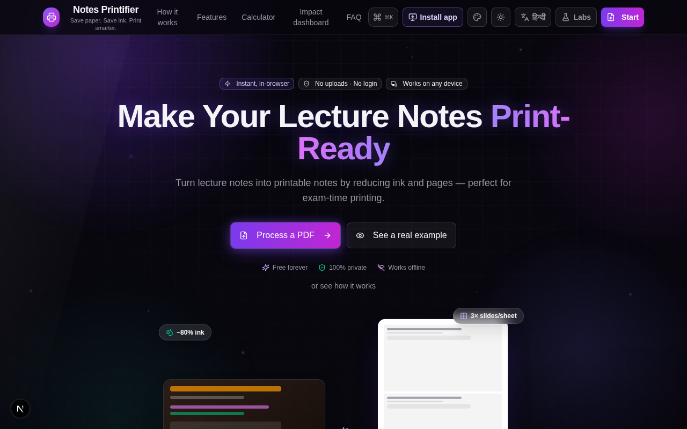
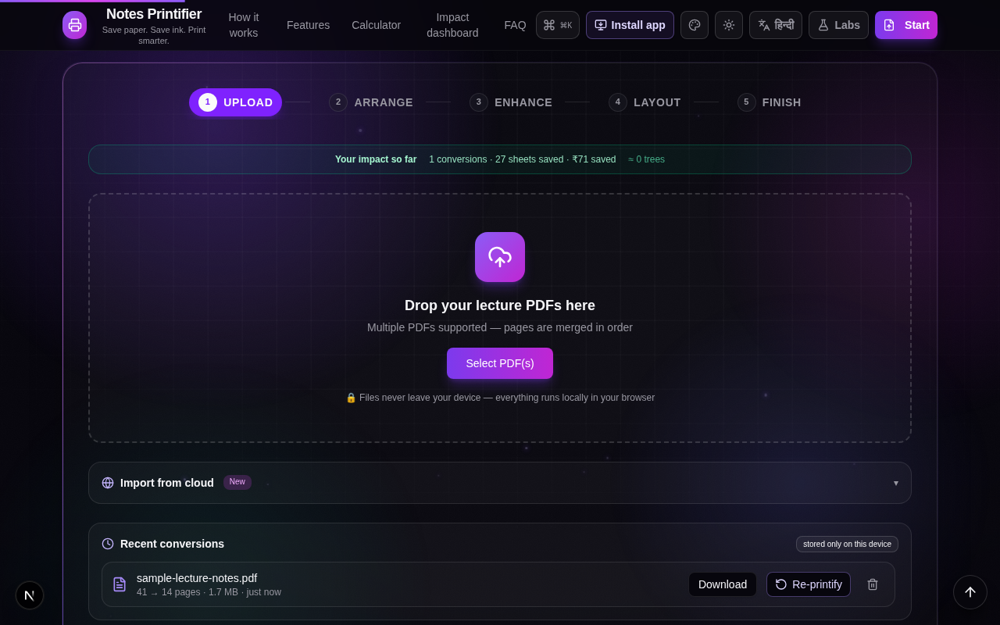
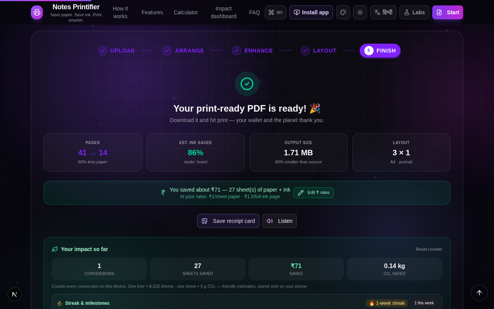

<div align="center">

# 🖨️ Notes Printifier

### Turn 41 ink-heavy slides into 14 bright pages. For ₹0. In your browser.

**Your notes never leave your device. No login. No upload. No mercy for xerox bills.**

[](https://avithegod2010.github.io/Notes-printifier/)
[](../../releases)
[](LICENSE)
[](../../actions)
[](#-features)

**Translation progress** ([help translate →](MISSING_TRANSLATIONS.md) · [📣 Translate-a-thon →](https://github.com/Avithegod2010/Notes-printifier/issues/20)):
[](MISSING_TRANSLATIONS.md)
[](MISSING_TRANSLATIONS.md)
[](MISSING_TRANSLATIONS.md)
[](MISSING_TRANSLATIONS.md)
[](MISSING_TRANSLATIONS.md)
[](MISSING_TRANSLATIONS.md)

</div>

---

<p align="center">
  
</p>

Every exam season, the same tragedy: **41 dark PowerPoint slides** hit the xerox shop, come back as 41 ghostly sheets of wasted paper, and eat ₹200 of your pocket money.

Notes Printifier flips them bright, stacks **3 per sheet**, and hands you a 14-page PDF. It even counts what you saved — paper, ink, trees, and rupees — because watching that number climb is half the fun.

> 🎉 **Real numbers from the sample lecture PDF:** `41 pages → 14 pages` · `86% ink saved` · `1.71 MB (60% smaller)` · `≈ ₹71 kept in your pocket`

---

## ✨ Features

| | |
|---|---|
| 🧩 **N-up print layouts** | 1×1 up to 3×3 slides per A4/Letter sheet, gaps tuned for hole-punching |
| 🌓 **Dark-slide inversion** | Lecturer's black theme → bright white paper, one toggle |
| 🖋 **Ink saver** | 2-tone posterization, grayscale, tint removal, blue-mark cleanup, edge trim |
| 📖 **Booklet mode** | Saddle-stitch ordering + fold guide — print a real booklet |
| 🔁 **Duplex pad** | Blank page inserted so double-sided backs line up |
| 🧠 **AI Print Doctor** | Ask for advice ("ink", "pages", "readability") and apply a suggested recipe |
| 🎙 **Voice commands** | "nine up", "black and white", "save ink" — EN + हिन्दी |
| 🔊 **Spoken receipt** | The result step can read your savings out loud |
| ✍️ **OCR + text repaint** | Searchable text layer; Labs repaints pages as crisp black-on-white text |
| 📐 **Auto deskew** | Phone photos of notes get straightened per page |
| 🎛 **Presets** | Economy / Balanced / Exam-cram built-ins + your own, shareable |
| 🎯 **Print budget** | "I can afford 25 sheets" → the layout auto-fits your limit |
| 🌱 **Impact meter** | Lifetime sheets / ₹ / trees / CO₂ saved, streaks and milestones |
| 🕘 **History re-run** | Yesterday's file, different settings, one tap (originals stay on-device) |
| ☁️ **Cloud import** | Paste a Google Drive / Dropbox link (self-hosted server proxy, SSRF-hardened) |
| 📱 **PWA + Android APK** | Install to home screen, or sideload the offline APK — with Android share-sheet support |
| 🗣 **Bilingual** | Every string in English and हिन्दी, incl. the spoken receipt |
| 🎨 **12 themes · 10 patterns** | Dark/light, ⌘K command palette, animated theme flip |

## 📸 Screenshots

<p align="center">
  
  &nbsp;&nbsp;
  
</p>

## 🚀 Try it — pick your fighter

| | Where | What you get |
|---|---|---|
| 🌍 **Web** | [avithegod2010.github.io/Notes-printifier](https://avithegod2010.github.io/Notes-printifier/) | The whole PDF pipeline: upload → arrange → enhance → layout → download/print/share. Installable PWA, works offline after first visit. |
| 🤖 **Android APK** | [Releases](../../releases) → `printifier.apk` | Same pipeline, fully offline, plus Android share-sheet ("share PDF → Printifier") and home-screen app icon. |
| 💻 **Self-host** | `bun install && bun run dev` | Everything above **plus** the server features (AI doctor, voice, Listen, cloud import, preset links, community stats). |

### ☁️ The GitHub Pages fine print (honesty section)

The live site is hosted on **GitHub Pages — free, fast, static file hosting with no backend**. The core app is pure browser magic and runs 100% there. A handful of features need Printifier's small server brain:

> AI Print Doctor · Voice commands · Listen (spoken receipt) · Cloud preset links & QR · Cloud import · Community stats

On the static site **they stay visible** — tap one and a friendly dialog explains the situation, with a **Why?** button for the full story (and how to get the full experience). Nothing is hidden; nothing fires doomed requests. Self-host (below) or use the server deployment to light them up.

## 🛠 Quick start

```bash
# you need bun (https://bun.sh) — node+npm works too, bun is just faster
bun install
bun run dev          # → http://localhost:3000  (full server features on)

bun run lint         # keep it clean
bunx tsc --noEmit    # types are not optional

# fully static export (what Pages hosts and the APK packages)
bun run build:static # → .next-static/

# signed offline APKs — see VERSIONING.md for the release ritual
bash android/build-apk.sh beta     # → public/printifier.apk
bash android/build-apk.sh stable   # → public/printifier-stable.apk
```

The APK pipeline is Gradle-free (`aapt2` + `ecj` + `d8` + `apksigner`) and needs Android
build-tools 34 + a JRE; override locations with `ANDROID_SDK=…` and `ECJ_JAR=…`.

### 🔑 APK signing

The keystore (`android/printifier.keystore`) and its password are **not in this repo** (checked the
whole git history — they never were). The build script reads the password from `$KS_PASS` or
`android/signing.local` (gitignored). On GitHub Actions, set the `KEYSTORE_BASE64` and `KS_PASS`
repository secrets and every `v*` tag builds a signed APK automatically. Lose the keystore and users
must uninstall/reinstall to update — back it up.

### 🗄 Database (optional, self-hosting only)

Static builds need no database. The full server uses Prisma + SQLite for two optional features —
copy `.env.example` → `.env` and `bun run db:push`:

- `POST /api/prints` — anonymous usage stats (hashed file name + page counts)
- `POST /api/presets` — shareable preset links & QR codes
- `GET /api/cloud-import?url=…` — Drive/Dropbox proxy (75 MB cap, per-hop SSRF validation)

## 🧭 Repository layout

```
src/app/                    Next.js App Router (page + optional API routes)
src/components/printifier/  the app (upload → arrange → enhance → layout → finish)
src/lib/pdf/                PDF.js render, compose pipeline (worker), filters, OCR
src/lib/                    i18n, zustand store, presets, theme, savings math
android/                    WebView APK source + Gradle-free build script
scripts/                    icon generators, static-export helper
docs/screenshots/           the images above
.github/workflows/          Pages deploy · CI · CodeQL · APK releases
```

## 🔒 Privacy

- **Files never leave your device.** Parsing, filtering and PDF generation all run locally —
  load the page once and it even works offline.
- History, presets and the impact meter live in IndexedDB/localStorage. Clear them any time.
- The only server call on self-hosted mode is an anonymous usage ping whose "file name" is a
  truncated SHA-256 hash, not the real name. On GitHub Pages, there are no server calls at all.
- Security model and reporting: [SECURITY.md](SECURITY.md).

## 🏷 Versioning & releases

Two release lines from one codebase: **stable** (frozen artifacts from the `stable` branch) and
**beta** (rolling, from `main`). Every release lives in [Releases](../../releases) — signed APKs as
assets, notes on what changed. See [VERSIONING.md](VERSIONING.md) for the ritual.

## 🤝 Contributing

PRs welcome! Keep it typed (`bunx tsc --noEmit`), linted (`bun run lint`), and remember: anything
that ships to the static site must work without a server. Bilingual strings live in
`src/lib/i18n.ts` as `key: ['English', 'हिन्दी']` pairs.

🌍 **Translator?** Join the [Translate-a-thon](https://github.com/Avithegod2010/Notes-printifier/issues/20) —
claim a section for मराठी / தமிழ் / বাংলা (or a new language) via the
[translation issue template](https://github.com/Avithegod2010/Notes-printifier/issues/new?template=translation.md).
Partial PRs welcome — untranslated keys fall back to English automatically.

## ⚖️ License

[MIT](LICENSE) — print freely. 🖨️
